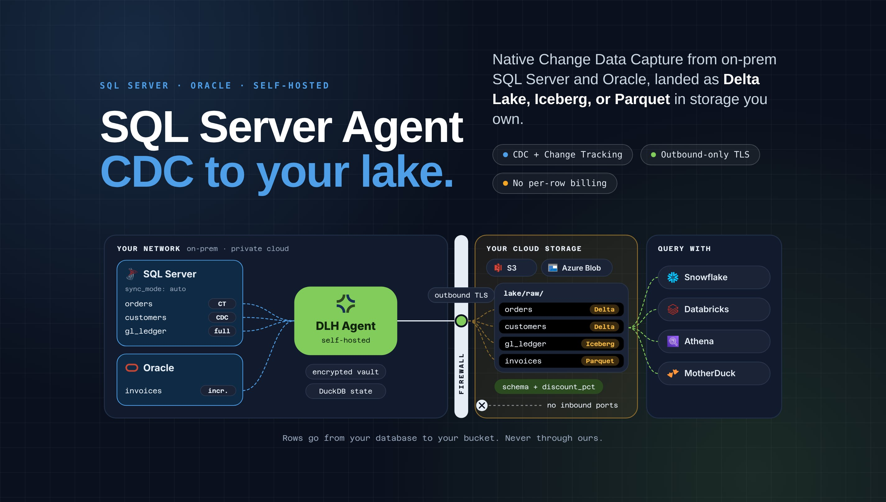

<picture>
  <source media="(prefers-color-scheme: dark)" srcset="assets/dlh_logo_white.svg">
  
</picture>

# DLH.io SQL Data Loader Agent



**Self-hosted CDC from SQL Server and Oracle to Delta Lake, Iceberg or Parquet in storage you own**

## What it does

The agent runs on a Windows server inside your network. It reads SQL Server
(Change Tracking, Change Data Capture or full loads) and Oracle (incremental)
and writes Delta Lake, Apache Iceberg, Parquet or CSV to your own Amazon S3 or
Azure storage. Connections are outbound-only TLS with no inbound ports, and
rows go from your database to your bucket, never through DLH.io.

- [Product page](https://datalakehouse.io/tools/sql-server-agent)
- [Documentation](https://datalakehouse.io/docs/connectors/agents/sql-server-agent)
- [Getting started](https://datalakehouse.io/docs/connectors/agents/sql-server-agent/getting-started)
- [CLI reference](https://datalakehouse.io/docs/connectors/agents/sql-server-agent/cli-reference)
- [Security](https://datalakehouse.io/docs/connectors/agents/sql-server-agent/security)
- [Changelog](https://datalakehouse.io/docs/connectors/agents/sql-server-agent/changelog)

## Editions

The free community edition needs no API key. It extracts up to 10,000 rows per
table or view and keeps output in the local output folder. Add a valid DLH.io
API key in the configuration to enable unlimited extraction and cloud upload.

[Request a Demo](https://datalakehouse.io/tools/sql-server-agent)

## Download

<!-- latest-release:start -->
The first public release is being published.
<!-- latest-release:end -->

Browse all files on the [Releases page](https://github.com/datalakehouse/dlh-agent-sql-data-loader-installer/releases)
or read the [Setup Guide](DLH-SQL-Data-Loader-Agent-Setup-Guide.pdf).

## Install (recommended)

Run this from an elevated PowerShell prompt on the Windows server that will run
the agent:

```powershell
$tag = 'v<version>'
$base = "https://github.com/datalakehouse/dlh-agent-sql-data-loader-installer/releases/download/$tag"
Invoke-WebRequest "$base/Install-DlhAgentSqlServer.ps1" -OutFile .\Install-DlhAgentSqlServer.ps1
.\Install-DlhAgentSqlServer.ps1 -InstallerUrl "$base/dlh-agent-for-sql-server-installer-v0.$($tag.TrimStart('v')).exe" -ExpectedSha256 '<installer SHA256>'
```

The bootstrap checks the installer SHA256 and verifies its
`DLH.io (AICG, Inc.)` signature before Setup starts. It installs silently and
returns Setup's exit code. Downloading the installer through the bootstrap
does not trigger the SmartScreen download prompt. If the server uses a proxy
or firewall allowlist, allow `github.com` and
`release-assets.githubusercontent.com`.

## Install (manual download)

Download the installer EXE from the
[Releases page](https://github.com/datalakehouse/dlh-agent-sql-data-loader-installer/releases).
Compare its hash with the published SHA256 value, and check its signature:

```powershell
$installer = '.\dlh-agent-for-sql-server-installer-v0.<version>.exe'
Get-FileHash $installer -Algorithm SHA256
Get-AuthenticodeSignature $installer | Format-List Status, StatusMessage, SignerCertificate
```

Confirm the signer is `DLH.io (AICG, Inc.)`. If Windows displays "Windows
protected your PC", select **More info**, confirm the publisher, then select
**Run anyway**. You can also use `Unblock-File` after verifying the hash and
signature. To run the bootstrap with an EXE you already downloaded, use its
`-InstallerPath` option:

```powershell
.\Install-DlhAgentSqlServer.ps1 -InstallerPath '.\dlh-agent-for-sql-server-installer-v0.<version>.exe' -ExpectedSha256 '<installer SHA256>'
```

## Why the SmartScreen prompt appears

Each new signed build starts with no download reputation, so SmartScreen may
show an unrecognized-app prompt while reputation develops. The installer is
signed with Microsoft Artifact Signing, but signing does not guarantee that
the prompt will disappear.

## Setup and configuration

Start with the [Setup Guide](DLH-SQL-Data-Loader-Agent-Setup-Guide.pdf). The
installer places a reference `dlh_agent_config.template.yaml` and example
configurations in `dlh_config_examples\` in the install folder. In
`dlh_agent_config.yaml`, set the database connection, the storage target and
your `dlh_ref` API key and GUIDs. Database passwords are stored encrypted, and
a valid API key enables unlimited extraction and cloud upload.

## Previous versions

Earlier root copies of the bootstrap script, `SHA256SUMS.txt`, and setup guide
are stored in `archive/<version>/`, where the version omits the leading `v`.
Older installer binaries remain available on the
[Releases page](https://github.com/datalakehouse/dlh-agent-sql-data-loader-installer/releases).

## Support

Open a [GitHub issue](https://github.com/datalakehouse/dlh-agent-sql-data-loader-installer/issues).
Do not include API keys, database credentials, configuration secrets, or
customer data in an issue. See the [DLH.io Trust Center](https://trust.inc/dlh)
and the [Data Processing Addendum](https://datalakehouse.io/legal/data-processing-addendum).

## Terms

The DLH.io SQL Data Loader Agent and its installer are proprietary software of
AICG, Inc. (DLH.io). The community edition is free to use. See [LICENSE](LICENSE)
and the [DLH.io Terms and Conditions](https://datalakehouse.io/legal/terms-and-conditions).

The PowerShell bootstrap script `Install-DlhAgentSqlServer.ps1` is licensed
under the MIT License, so your IT team can review and adapt it.
